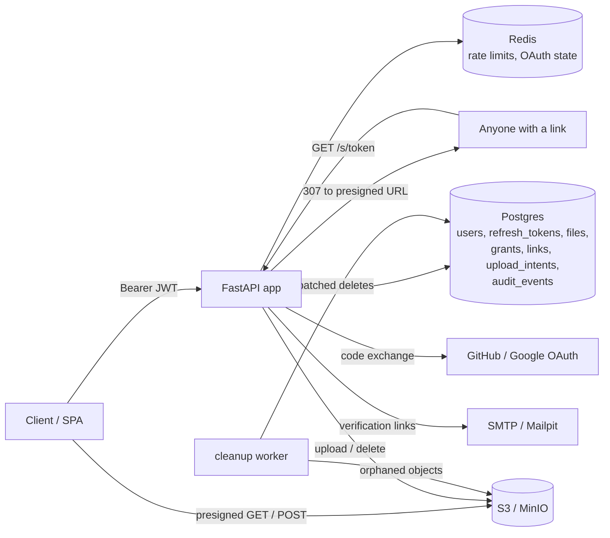
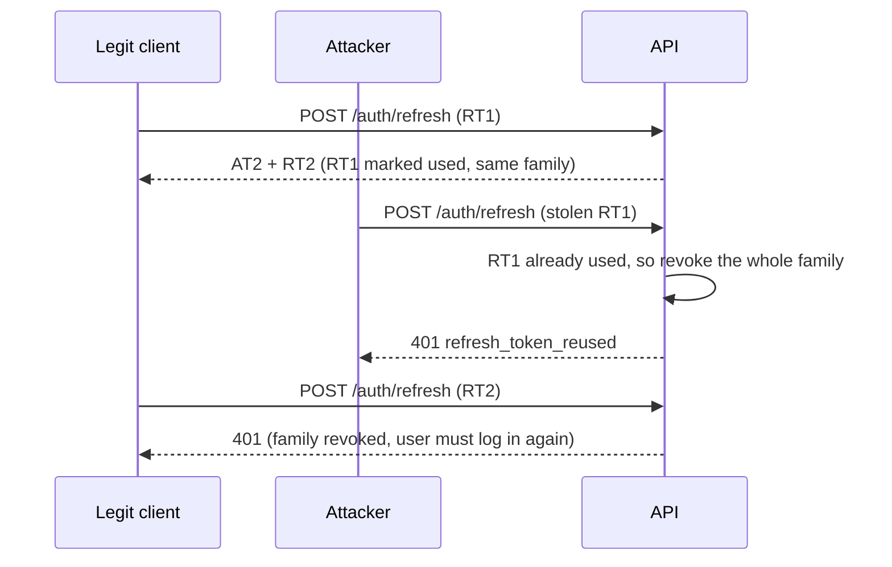
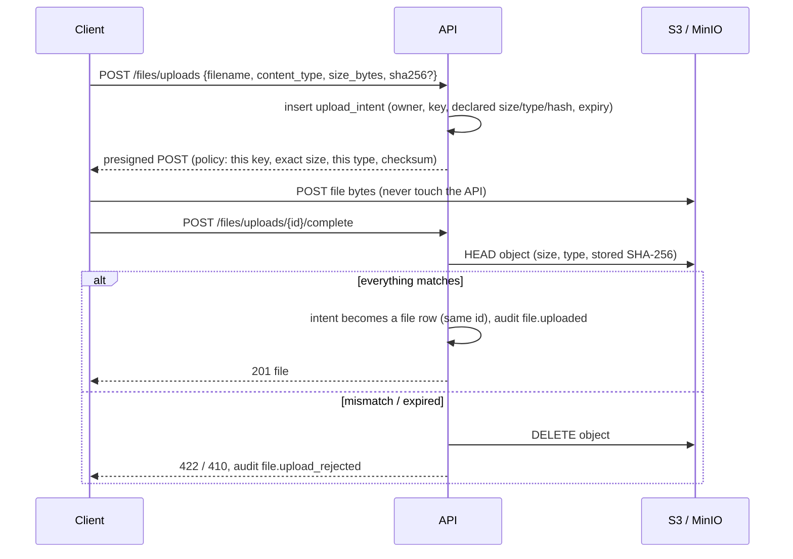
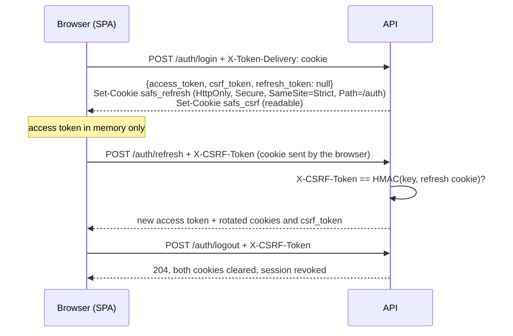

# Secure Auth & File Share

[](https://github.com/mananbatraa/secure-auth-file-share/actions/workflows/ci.yml)

A FastAPI backend with production-style authentication and file sharing:

- **JWT access tokens** (short-lived) plus **opaque refresh tokens with rotation and reuse detection**. Replaying a rotated refresh token revokes the whole session family.
- **Instant revocation**: "log out everywhere", password changes, role changes and deactivation invalidate outstanding access tokens immediately, without a token blocklist.
- **OAuth login** with GitHub and Google (authorization code + `state` + PKCE), linking accounts by *verified* email only.
- **Email verification** for password sign-ups: signed, expiring links bound to the address; unverified accounts can sign in and read what is shared with them but can't upload or share. Signing in with OAuth over an unverified squatted account strips its password and sessions (pre-account-takeover defense).
- **Password reset by email** that doesn't reveal which addresses have accounts, with single-use links bound to the current password and a sign-out everywhere on success.
- **Browser sessions without exposing the refresh token**: opt in to an HttpOnly, SameSite=Strict refresh cookie, protected by a signed double-submit CSRF token.
- **RBAC** (`admin`, `member`, `guest`) mapped to explicit permissions.
- **Rate-limited login**: Redis sliding-window limits per account and per IP, run atomically in one Lua script.
- **File sharing on S3/MinIO**: uploads are hashed and size-capped, downloads go through **short-lived presigned URLs**, per-file **viewer/editor grants** (optionally expiring), and anonymous **share links** with an expiry and an optional download cap that holds under concurrency.
- **Direct-to-S3 uploads** for large files: a presigned POST pinned to the key, exact size, content type and SHA-256, followed by a confirm step that re-verifies the stored object and deletes anything that doesn't match.
- **Append-only audit log** of every security-relevant event (logins with failure reason, throttling, token reuse, admin changes, grants, share-link use), enforced by a Postgres trigger and queryable by admins.
- **Background cleanup worker** that removes expired upload intents (and the objects they left in S3), expired refresh tokens, grants and dead share links in small `SKIP LOCKED` batches.
- Postgres via async SQLAlchemy 2, **Alembic** migrations, Docker Compose stack, CI on GitHub Actions, **227 tests at 98% coverage**, `ruff` + strict `mypy`.

## Architecture



File bytes never stream back through the API. The API authorizes the request, then hands the client a presigned URL that is valid for seconds or minutes. Large uploads can skip the API too (see below).

```
app/
  core/       config (env vars), security (Argon2id, JWT), RBAC, domain errors
  models/     SQLAlchemy models: User, OAuthAccount, RefreshToken, StoredFile, FilePermission,
              ShareLink, UploadIntent, AuditEvent
  services/   auth (rotation), oauth, files (permissions, links, direct uploads), storage (S3),
              rate_limit (Lua), audit, cleanup (expiry sweeps), email_verification, mailer
  api/        routes + dependencies (current user, permission checks)
  resources.py  process-wide pools/clients, built in the app lifespan
  cleanup.py    `python -m app.cleanup` worker entry point
alembic/      migrations
tests/        unit + API tests (real Postgres, fakeredis/real Redis, moto S3 server)
```

### Refresh-token rotation and reuse detection



The token row is read with `SELECT … FOR UPDATE`, so two simultaneous refreshes with the same token serialize: exactly one wins, and the other is treated as a replay.

### Direct-to-S3 uploads



S3 enforces the POST policy, but the confirm step does not rely on it: it compares the stored object with what was declared, using S3's stored full-object SHA-256 when there is one and otherwise streaming the object to hash it. Intents are single-use, owner-scoped (another user gets `404`) and expire with the policy.

### Audit log

Every security-relevant action writes an `audit_events` row with the actor, target, outcome, client IP, user agent and request ID. Success events are staged in the same transaction as the action, so an action and its audit row commit or roll back together; failures (bad password, throttled login, rejected share link) are written on their own because the action itself never commits. A trigger rejects `UPDATE` and `DELETE` on the table, and `actor_id` has no foreign key, so the trail survives user deletion.

```bash
# Failed logins in the last hour, newest first; follow next_before_id to page
curl -s "$API/admin/audit?action=auth.login&outcome=failure&since=2026-11-20T10:00:00Z" \
  -H "authorization: Bearer $ADMIN_AT"
```

### Email verification

Registration mails a link to `EMAIL_VERIFICATION_URL` (your frontend) carrying a token; the frontend POSTs it to `/auth/verify-email`. Until then the account can sign in, see what others shared with it and download, but uploads, grants and share links return `403 email_not_verified` (`REQUIRE_VERIFIED_EMAIL=false` turns this off). `/auth/verify-email/resend` sends a new link, at most `EMAIL_VERIFICATION_RESEND_LIMIT` per hour per account. A mail outage never fails sign-up; the user can resend later.

The token is a JWT with its own audience (it can't be used as an access token, nor an access token as it), a 24 h expiry, the user id and a SHA-256 fingerprint of the address. Changing the address kills outstanding links, and the token never contains the address itself. No table is needed because verifying is idempotent.

OAuth sign-ins count as verified, since accounts are only linked on a provider-verified email. That opens one trap: someone registers the victim's address with a password and waits for the victim to sign in with Google, after which both would share the account. So when OAuth links to an account whose email was never verified, the unproven password is removed and its sessions and access tokens are revoked (audited as `auth.unverified_password_removed`).

### Password reset

`POST /auth/password-reset/request {"email": ...}` always answers `202 {"status": "accepted"}`. If the account exists and is active it gets a link to `PASSWORD_RESET_URL` (your frontend), which POSTs the token and the new password to `/auth/password-reset/confirm`. Three things keep the endpoint from becoming an account oracle: the response is identical, the mail is sent as a background task *after* the response so timing is identical too, and the throttle (`PASSWORD_RESET_MAX_PER_EMAIL` per address, `PASSWORD_RESET_MAX_PER_IP` per IP, per hour) is keyed on the address whether or not it exists.

The token is a 30-minute JWT with its own audience, bound to the user, a fingerprint of the address and an HMAC of the **current password hash**. Setting any new password changes that hash, so:

- a link works exactly once, with no table to store used tokens;
- requesting two links and using one kills the other;
- a normal password change also kills every outstanding reset link.

Confirming locks the user row, so five concurrent confirms with one token let exactly one through (there is a test). A successful reset revokes every session and live access token, and marks the address verified, since the user just proved they read that inbox. OAuth-only accounts can use it to add a password. Requests (including for unknown addresses) and confirmations are audited.

### Browser sessions (refresh token in a cookie)

Keeping a refresh token in `localStorage` hands it to any XSS. Browser clients can instead send `X-Token-Delivery: cookie` on `/auth/login`:



`/auth/refresh` and `/auth/logout` take the token from the JSON body if present (API clients, unchanged) and otherwise from the cookie, in which case the `X-CSRF-Token` header must equal an HMAC of that refresh token under the server key. SameSite=Strict already stops cross-site sends; the CSRF token is the second layer. Because it is derived from the refresh token, it rotates with it, needs no storage, and cannot be forged by someone who can only plant cookies (a sibling subdomain, for example), which a plain double-submit cookie would allow. Reuse detection works exactly as for body tokens. CORS is configured with credentials, so `CORS_ORIGINS` must list explicit origins; `*` is refused at startup, as is `COOKIE_SECURE=false` in production.

### Background cleanup

`python -m app.cleanup` sweeps expired data; Compose runs it as the `cleanup` service (every `CLEANUP_INTERVAL_SECONDS`, default one hour). Use `--once` for cron or a Kubernetes CronJob (it exits non-zero if the sweep fails) and `--dry-run` to only count.

| What | Removed when |
|------|--------------|
| Upload intents + their S3 object | expired more than `CLEANUP_UPLOAD_GRACE_SECONDS` ago (default 1 h, always longer than the 5-minute completion grace) |
| Refresh tokens | expired more than `CLEANUP_RETENTION_SECONDS` ago (default 7 days) |
| File grants | past `expires_at` (they already grant nothing) |
| Share links | expired or revoked more than `CLEANUP_RETENTION_SECONDS` ago |

Each sweep deletes in batches of `CLEANUP_BATCH_SIZE`, one short transaction per batch, selecting rows with `FOR UPDATE SKIP LOCKED`. Several workers can run at once, and a row that a request holds (an upload being confirmed right now) is skipped and picked up next time instead of blocking either side. Intent rows are deleted before their objects: once the row is gone nothing can complete the upload, so the object delete can't race a completion, and a failed object delete only leaves an unreferenced object. A sweep that removed anything writes one `maintenance.cleanup` audit event with the counts.

## Running it

### Docker Compose (everything)

```bash
docker compose up --build
# API + Swagger UI: http://localhost:8000/docs
# MinIO console:    http://localhost:9001  (minioadmin / minioadmin)
# Mailpit (emails): http://localhost:8025
```

The `migrate` service runs `alembic upgrade head` before the API starts. To enable OAuth, export `GITHUB_CLIENT_ID`/`GITHUB_CLIENT_SECRET` (callback `http://localhost:8000/auth/oauth/github/callback`) and/or the Google equivalents before `up`.

### Quick tour with curl

```bash
API=http://localhost:8000
curl -s -XPOST $API/auth/register -H 'content-type: application/json' \
  -d '{"email":"alice@example.com","password":"correct-horse-battery-staple"}'
# Open Mailpit (http://localhost:8025), copy the token from the link, then:
curl -s -XPOST $API/auth/verify-email -H 'content-type: application/json' -d '{"token":"<token>"}'
TOKENS=$(curl -s -XPOST $API/auth/login -H 'content-type: application/json' \
  -d '{"email":"alice@example.com","password":"correct-horse-battery-staple"}')
AT=$(echo $TOKENS | jq -r .access_token)

FILE=$(curl -s -XPOST $API/files -H "authorization: Bearer $AT" -F upload=@README.md)
ID=$(echo $FILE | jq -r .id)

curl -s "$API/files/$ID/download?ttl=120" -H "authorization: Bearer $AT"     # presigned URL
curl -s -XPOST $API/files/$ID/links -H "authorization: Bearer $AT" \
  -H 'content-type: application/json' -d '{"expires_in_seconds":3600,"max_downloads":3}'
```

### Local development

```bash
uv sync
docker compose up -d postgres redis minio mailpit
cp .env.example .env            # set JWT_SECRET
uv run alembic upgrade head
uv run uvicorn app.main:app_factory --factory --reload
```

### Tests and checks

```bash
docker compose up -d postgres redis
createdb -h localhost -U postgres fileshare_test   # once
uv run pytest --cov=app        # 227 tests
uv run ruff check . && uv run ruff format --check . && uv run mypy
```

The test suite runs migrations from scratch, then exercises the API against real Postgres, a moto S3 server on a local port (so presigned URLs are really fetched over HTTP), and fakeredis. A real Redis is used too when `TEST_REDIS_URL` is reachable. Override `TEST_DATABASE_URL` if your Postgres differs.

## API

| Method | Path | Who | Notes |
|---|---|---|---|
| POST | `/auth/register` | anyone | password ≥ 12 chars, not containing the email name |
| POST | `/auth/verify-email` | anyone with the link | `{"token": ...}`; idempotent; `400 invalid_verification_token` if expired, forged or for an old address |
| POST | `/auth/verify-email/resend` | unverified user | `202`; `409` if already verified; `429` past the hourly cap |
| POST | `/auth/login` | anyone | rate limited per account and per IP; `429` + `Retry-After`; `X-Token-Delivery: cookie` for browser sessions |
| POST | `/auth/password-reset/request` | anyone | `{"email": ...}`; always `202`; `429` past the per-address or per-IP cap |
| POST | `/auth/password-reset/confirm` | anyone with the link | `{"token", "new_password"}`; `204`, signs out everywhere; `400 invalid_reset_token` if used, expired or stale |
| POST | `/auth/refresh` | refresh token (body, or cookie + `X-CSRF-Token`) | rotates; replay → `401 refresh_token_reused`; bad CSRF → `403 csrf_failed` |
| POST | `/auth/logout` | refresh token (body, or cookie + `X-CSRF-Token`) | revokes that session (token family); clears cookies |
| POST | `/auth/logout-all` | user | revokes all sessions and live access tokens |
| POST | `/auth/change-password` | user | also logs out everywhere |
| GET | `/auth/oauth/{github,google}/authorize` | anyone | 302 to provider |
| GET | `/auth/oauth/{provider}/callback` | provider | returns a token pair |
| GET | `/users/me` | user | |
| GET/PATCH | `/admin/users[/{id}]` | admin | change role / deactivate (takes effect immediately) |
| POST/GET | `/files` | member+ / user | multipart upload (`upload` field); list `?scope=owned\|shared\|all` |
| POST | `/files/uploads` | member+ | start a direct-to-S3 upload; returns presigned POST `url` + `fields` |
| POST | `/files/uploads/{id}/complete` | uploader | verify the object and create the file |
| GET/PATCH/DELETE | `/files/{id}` | viewer / editor / owner | |
| GET | `/files/{id}/download?ttl=` | viewer | presigned URL, TTL clamped to server max |
| POST/GET/DELETE | `/files/{id}/permissions[/{user_id}]` | owner | grant `viewer`/`editor`, optional expiry |
| POST/GET/DELETE | `/files/{id}/links[/{link_id}]` | owner | anonymous links, expiry + download cap |
| GET | `/s/{token}` | anyone | `307` to a 60 s presigned URL; `410` if expired, revoked or used up |
| GET | `/admin/audit` | admin | filter by `action` (exact or `prefix.`), `outcome`, `actor_id`, `target_type`/`target_id`, `since`/`until`; keyset paging via `before_id` |
| GET | `/healthz`, `/readyz` | anyone | readiness checks Postgres, Redis and S3 |

Errors share one shape: `{"error": {"code": "permission_denied", "message": "..."}}`.

## Design decisions

- **Opaque refresh tokens, stored hashed.** Refresh tokens are 256-bit random strings. Only their SHA-256 is stored, so a database leak doesn't hand out sessions. They are opaque rather than JWTs because they must be revocable and single-use anyway, which needs a database row.
- **`token_version` instead of an access-token blocklist.** Each user row carries a counter that is embedded in every access token. The API already loads the user on each request, so comparing the counter costs nothing extra, and bumping it kills every outstanding access token at once.
- **Concurrent refresh counts as reuse.** Two refreshes with the same token are indistinguishable from a replay, so the family is revoked. Real clients should serialize refreshes. A short grace window would be friendlier but weakens theft detection; this project chooses strictness.
- **Login throttling fails closed.** If Redis is down, logins return `503` rather than allowing unlimited guessing (`RATE_LIMIT_FAIL_OPEN=true` flips this). Every attempt counts against the account bucket, and a successful login clears it.
- **`X-Forwarded-For` is ignored by default.** Otherwise an attacker could rotate a spoofed header to get a fresh IP bucket on each try. Set `TRUST_PROXY_HEADERS=true` only behind a proxy you control.
- **404, not 403, for files you can't see.** This doesn't confirm that a file ID exists. Users who can see a file but lack the level for an action get `403`.
- **Downloads are always `Content-Disposition: attachment`.** An uploaded HTML or SVG file can't render as a page, so it can't run script. Storage keys are server-generated (`files/{owner}/{uuid}`), and user filenames are only display metadata.
- **Atomic download caps.** Redeeming a share link is a single conditional `UPDATE … WHERE download_count < max_downloads RETURNING`. Twelve concurrent hits on a 3-download link give exactly three redirects (there is a test for this).
- **Argon2id** password hashing. Unknown emails still run a dummy verification, so response time doesn't reveal which accounts exist.
- **PKCE on OAuth** even for confidential clients, plus single-use `state` stored in Redis (`GETDEL`) and bound to the provider. Accounts are linked by email only when the provider says that email is verified; otherwise an attacker could take over an existing account.
- **Verify uploads after the fact.** A presigned POST policy is only as good as the storage backend that enforces it (moto, for one, ignores it). The confirm step checks size, content type and checksum against the stored object, so a client can't swap in different bytes, even against a lax backend.
- **Audit ids are a Postgres identity, not UUIDs.** `created_at` is the transaction start time, so events inside one transaction tie; a monotonically increasing id gives a total order and a cheap keyset cursor. Retention would be done by a privileged role (or by partitioning by month and dropping old partitions), never by the app's own credentials.
- **Verification gates writes, not sign-in.** Blocking login until verification makes typos unrecoverable and pushes people to re-register; gating uploads and sharing is what actually stops an unverified address from being used to distribute files. The link targets a frontend page that POSTs the token, so mail scanners that prefetch links can't verify anything by a GET.
- **Cleanup keeps dead rows for a while.** Expired refresh tokens stay for the retention period, so for a week a replayed old token is still reported as reuse in the audit log instead of looking like garbage, and owners still see recently expired links. Deleting a rotated token never breaks its successor (`replaced_by_id` is `ON DELETE SET NULL`).
- **Reset tokens are bound to the password, not stored.** A table of used tokens would work, but binding the token to an HMAC of the password hash gives single use, "a newer reset wins" and "a password change revokes pending resets" for free. The HMAC (rather than a plain digest) keeps the readable JWT from carrying anything derived from the stored hash that could be checked offline.
- **Cookie delivery is opt-in per login.** API and mobile clients keep the simple JSON contract; browsers get the HttpOnly cookie. Mixing is safe because a body token always wins and never needs CSRF (a cross-site page can't read or send it).
- **Pinned JWT algorithm and audience/issuer checks.** `alg=none` and algorithm substitution are rejected (there are tests for both).

## Configuration

All settings are environment variables (see [`.env.example`](.env.example) and `app/core/config.py`). Startup refuses a missing or short `JWT_SECRET` when `ENVIRONMENT=production`, and Swagger UI is disabled there.

## License

MIT
