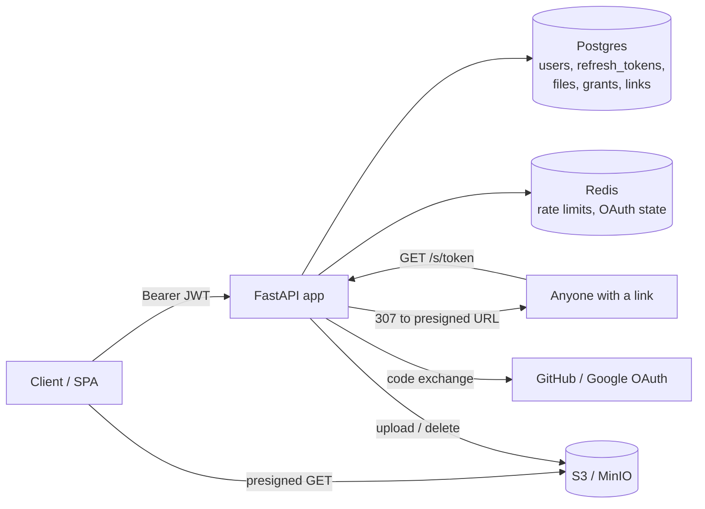
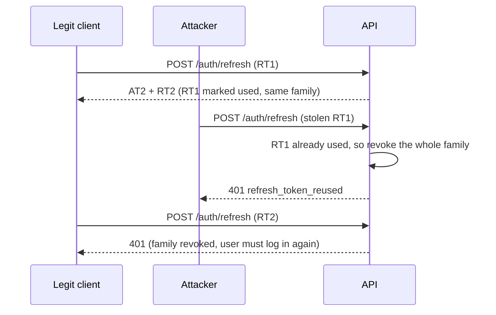

# Secure Auth & File Share

[](https://github.com/mananbatraa/secure-auth-file-share/actions/workflows/ci.yml)

A FastAPI backend with production-style authentication and file sharing:

- **JWT access tokens** (short-lived) plus **opaque refresh tokens with rotation and reuse detection**. Replaying a rotated refresh token revokes the whole session family.
- **Instant revocation**: "log out everywhere", password changes, role changes and deactivation invalidate outstanding access tokens immediately, without a token blocklist.
- **OAuth login** with GitHub and Google (authorization code + `state` + PKCE), linking accounts by *verified* email only.
- **RBAC** (`admin`, `member`, `guest`) mapped to explicit permissions.
- **Rate-limited login**: Redis sliding-window limits per account and per IP, run atomically in one Lua script.
- **File sharing on S3/MinIO**: uploads are hashed and size-capped, downloads go through **short-lived presigned URLs**, per-file **viewer/editor grants** (optionally expiring), and anonymous **share links** with an expiry and an optional download cap that holds under concurrency.
- Postgres via async SQLAlchemy 2, **Alembic** migrations, Docker Compose stack, CI on GitHub Actions, **140 tests at 98% coverage**, `ruff` + strict `mypy`.

## Architecture



File bytes never stream back through the API. The API authorizes the request, then hands the client a presigned URL that is valid for seconds or minutes.

```
app/
  core/       config (env vars), security (Argon2id, JWT), RBAC, domain errors
  models/     SQLAlchemy models: User, OAuthAccount, RefreshToken, StoredFile, FilePermission, ShareLink
  services/   auth (rotation), oauth, files (permissions, links), storage (S3), rate_limit (Lua)
  api/        routes + dependencies (current user, permission checks)
  resources.py  process-wide pools/clients, built in the app lifespan
alembic/      migrations
tests/        unit + API tests (real Postgres, fakeredis/real Redis, moto S3 server)
```

### Refresh-token rotation and reuse detection



The token row is read with `SELECT … FOR UPDATE`, so two simultaneous refreshes with the same token serialize: exactly one wins, and the other is treated as a replay.

## Running it

### Docker Compose (everything)

```bash
docker compose up --build
# API + Swagger UI: http://localhost:8000/docs
# MinIO console:    http://localhost:9001  (minioadmin / minioadmin)
```

The `migrate` service runs `alembic upgrade head` before the API starts. To enable OAuth, export `GITHUB_CLIENT_ID`/`GITHUB_CLIENT_SECRET` (callback `http://localhost:8000/auth/oauth/github/callback`) and/or the Google equivalents before `up`.

### Quick tour with curl

```bash
API=http://localhost:8000
curl -s -XPOST $API/auth/register -H 'content-type: application/json' \
  -d '{"email":"alice@example.com","password":"correct-horse-battery-staple"}'
TOKENS=$(curl -s -XPOST $API/auth/login -H 'content-type: application/json' \
  -d '{"email":"alice@example.com","password":"correct-horse-battery-staple"}')
AT=$(echo $TOKENS | jq -r .access_token)

FILE=$(curl -s -XPOST $API/files -H "authorization: Bearer $AT" -F upload=@README.md)
ID=$(echo $FILE | jq -r .id)

curl -s "$API/files/$ID/download?ttl=120" -H "authorization: Bearer $AT"     # presigned URL
curl -s -XPOST $API/files/$ID/links -H "authorization: Bearer $AT" \
  -H 'content-type: application/json' -d '{"expires_in_seconds":3600,"max_downloads":3}'
```

### Local development

```bash
uv sync
docker compose up -d postgres redis minio
cp .env.example .env            # set JWT_SECRET
uv run alembic upgrade head
uv run uvicorn app.main:app_factory --factory --reload
```

### Tests and checks

```bash
docker compose up -d postgres redis
createdb -h localhost -U postgres fileshare_test   # once
uv run pytest --cov=app        # 140 tests
uv run ruff check . && uv run ruff format --check . && uv run mypy
```

The test suite runs migrations from scratch, then exercises the API against real Postgres, a moto S3 server on a local port (so presigned URLs are really fetched over HTTP), and fakeredis. A real Redis is used too when `TEST_REDIS_URL` is reachable. Override `TEST_DATABASE_URL` if your Postgres differs.

## API

| Method | Path | Who | Notes |
|---|---|---|---|
| POST | `/auth/register` | anyone | password ≥ 12 chars, not containing the email name |
| POST | `/auth/login` | anyone | rate limited per account and per IP; `429` + `Retry-After` |
| POST | `/auth/refresh` | refresh token | rotates; replay → `401 refresh_token_reused` |
| POST | `/auth/logout` | refresh token | revokes that session (token family) |
| POST | `/auth/logout-all` | user | revokes all sessions and live access tokens |
| POST | `/auth/change-password` | user | also logs out everywhere |
| GET | `/auth/oauth/{github,google}/authorize` | anyone | 302 to provider |
| GET | `/auth/oauth/{provider}/callback` | provider | returns a token pair |
| GET | `/users/me` | user | |
| GET/PATCH | `/admin/users[/{id}]` | admin | change role / deactivate (takes effect immediately) |
| POST/GET | `/files` | member+ / user | multipart upload (`upload` field); list `?scope=owned\|shared\|all` |
| GET/PATCH/DELETE | `/files/{id}` | viewer / editor / owner | |
| GET | `/files/{id}/download?ttl=` | viewer | presigned URL, TTL clamped to server max |
| POST/GET/DELETE | `/files/{id}/permissions[/{user_id}]` | owner | grant `viewer`/`editor`, optional expiry |
| POST/GET/DELETE | `/files/{id}/links[/{link_id}]` | owner | anonymous links, expiry + download cap |
| GET | `/s/{token}` | anyone | `307` to a 60 s presigned URL; `410` if expired, revoked or used up |
| GET | `/healthz`, `/readyz` | anyone | readiness checks Postgres, Redis and S3 |

Errors share one shape: `{"error": {"code": "permission_denied", "message": "..."}}`.

## Design decisions

- **Opaque refresh tokens, stored hashed.** Refresh tokens are 256-bit random strings. Only their SHA-256 is stored, so a database leak doesn't hand out sessions. They are opaque rather than JWTs because they must be revocable and single-use anyway, which needs a database row.
- **`token_version` instead of an access-token blocklist.** Each user row carries a counter that is embedded in every access token. The API already loads the user on each request, so comparing the counter costs nothing extra, and bumping it kills every outstanding access token at once.
- **Concurrent refresh counts as reuse.** Two refreshes with the same token are indistinguishable from a replay, so the family is revoked. Real clients should serialize refreshes. A short grace window would be friendlier but weakens theft detection; this project chooses strictness.
- **Login throttling fails closed.** If Redis is down, logins return `503` rather than allowing unlimited guessing (`RATE_LIMIT_FAIL_OPEN=true` flips this). Every attempt counts against the account bucket, and a successful login clears it.
- **`X-Forwarded-For` is ignored by default.** Otherwise an attacker could rotate a spoofed header to get a fresh IP bucket on each try. Set `TRUST_PROXY_HEADERS=true` only behind a proxy you control.
- **404, not 403, for files you can't see.** This doesn't confirm that a file ID exists. Users who can see a file but lack the level for an action get `403`.
- **Downloads are always `Content-Disposition: attachment`.** An uploaded HTML or SVG file can't render as a page, so it can't run script. Storage keys are server-generated (`files/{owner}/{uuid}`), and user filenames are only display metadata.
- **Atomic download caps.** Redeeming a share link is a single conditional `UPDATE … WHERE download_count < max_downloads RETURNING`. Twelve concurrent hits on a 3-download link give exactly three redirects (there is a test for this).
- **Argon2id** password hashing. Unknown emails still run a dummy verification, so response time doesn't reveal which accounts exist.
- **PKCE on OAuth** even for confidential clients, plus single-use `state` stored in Redis (`GETDEL`) and bound to the provider. Accounts are linked by email only when the provider says that email is verified; otherwise an attacker could take over an existing account.
- **Pinned JWT algorithm and audience/issuer checks.** `alg=none` and algorithm substitution are rejected (there are tests for both).

## Configuration

All settings are environment variables (see [`.env.example`](.env.example) and `app/core/config.py`). Startup refuses a missing or short `JWT_SECRET` when `ENVIRONMENT=production`, and Swagger UI is disabled there.

## License

MIT
